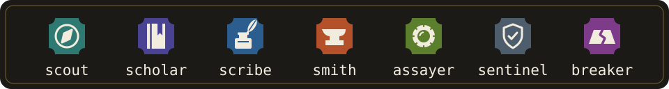
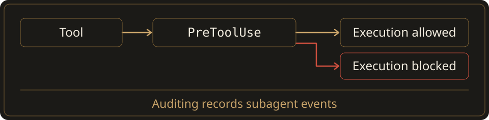

# Oathbound


A portable set of governance, execution rules, specialized subagents, deterministic hook guardrails, audit trails and engineering skills for CLI-based AI assistants.

Documentation, prompts and diagnostics use English. Existing file paths, command flags, machine identifiers and JSON schema keys remain unchanged for compatibility. No renaming or migration is required.

- **Stage:** alpha / incomplete, with prototypes under calibration (version in [VERSION](VERSION) and history in [CHANGELOG.md](CHANGELOG.md)).
- **Stack:** native TypeScript and JavaScript on **Node.js 24+** (native type stripping, no build step and no external dependencies).
- **Supported targets:** **Claude Code** (`claude`), **Antigravity CLI** (`agy`) and **Codex CLI** (plugin, agents and optional hooks).

---

## What the Project Does

1. **Governance Rules:** `oathkeeper` applies the shared workflow as an agent in Claude Code and Antigravity CLI, and as a profile in Codex CLI. Each project defines its local exceptions.
2. **Specialized Subagents:** `oathkeeper` coordinates 7 subagents: `scout`, `scholar`, `scribe`, `smith`, `assayer`, `sentinel` and `breaker`.

   

3. **Engineering Skills:** [`api-contract-design`](skills/api-contract-design/SKILL.md), [`architecture-advisor`](skills/architecture-advisor/SKILL.md), [`create-adr`](skills/create-adr/SKILL.md), [`create-spec`](skills/create-spec/SKILL.md), `diagnosing-bugs`, `grill-me`, [`incident-postmortem`](skills/incident-postmortem/SKILL.md), `migration`, [`refactor-safely`](skills/refactor-safely/SKILL.md), `surgical-patch` and [`test-strategy`](skills/test-strategy/SKILL.md). Skills with CLI-specific tools support an optional `SKILL.<runner>.md` override (ADR 0006). `scribe` loads `create-adr` and `create-spec` on demand.
4. **Deterministic Hooks:** Runtime auditing and protection through `agent-audit`, `readonly-guard`, `read-size-guard` and `destructive-guard` in the native Rust binary (`native/oathbound-hook`), which also provides `statusline`. Command rewriting uses official RTK hooks.

   

5. **Telemetry, Reports and Prototypes:** Includes `audit-resumo`, cost and difficulty modules (`test/custo`, `test/dificuldade`) and inactive Jev prototypes (`claude/hooks/skill-suggest.js`, `test/jev/revisar-teste.js`) documented in ADRs [docs/adr/0001-sugestao-de-skill-com-jev.md](docs/adr/0001-sugestao-de-skill-com-jev.md), [docs/adr/0002-roteamento-de-subagentes-com-jev.md](docs/adr/0002-roteamento-de-subagentes-com-jev.md) and [docs/adr/0003-jev-revisao-de-testes.md](docs/adr/0003-jev-revisao-de-testes.md).

---

## Installation

Oathbound can be installed as a native plugin or through the Node.js installer.

### 1. Native Plugin

In Claude Code, install from the marketplace with `/plugin install oathbound --marketplace RaphaelVSouza/Oathbound`.

If you already use the marketplace, update it and reload the plugin through the `/plugin` panel. If you use the release package, generate or extract the new version into another directory and point Claude to it.

To start an Oathbound session in Claude, use `claude --agent oathbound:oathkeeper`. In agy, use `agy agents` to check available agents and select `oathkeeper` with `agy --agent oathkeeper`.

Start the CLI normally to keep the default agent. During the session, request the desired subagent, for example, `oathbound:scout` in the Claude plugin or `scout` in agy.

In the Claude plugin, the hook applies guards by the `oathbound:<agent>` identifier and records blocks. New logs use mode `0600` on Unix and inherit directory permissions on Windows. Older logs may contain details recorded by previous versions.

With Dynamic Workflows enabled in Claude, run `/oathbound:revisao-arquitetura` and provide the decision, modules and constraints. The workflow compares contracts, operations and migration. The fourth call checks references and gathers input for an ADR. Approve the decision before requesting implementation or an ADR record.
Source manifests are separate for each harness: [Claude Code](.claude-plugin/plugin.json), with its [marketplace](.claude-plugin/marketplace.json), and [Antigravity](.antigravity-plugin/plugin.json). To generate independent native packages, specify new directories inside the repository:

```sh
node tools/build-plugin.cjs claude dist/claude
node tools/build-plugin.cjs agy dist/agy
claude plugin validate dist/claude
agy plugin validate dist/agy
```

Create `dist/` before generating packages. The generator requires new destinations. Each package contains the skills and eight agents. The Claude package includes per-agent guards and bundles the native hook as `native/bin/oathbound-hook` (`.exe` when the source binary is a `.exe`). Build the hook first with `cargo build --locked --release --manifest-path native/oathbound-hook/Cargo.toml`, or set `OATHBOUND_NATIVE_BIN`. The Claude build fails when no binary is found. Packages from `agy` and `codex` do not bundle it. See [tools/README.md](tools/README.md) for the lookup order.

Releases publish one Claude package per target, `oathbound-claude-<version>-<platform>-<arch>.tar.gz` (`linux-x64`, `win32-x64`, `darwin-arm64`), each with the hook for its own OS. Pick the one that matches your system. `oathbound-agy-<version>.tar.gz` and `oathbound-codex-<version>.tar.gz` carry no binary. Verify downloads with `sha256sum -c SHA256SUMS`.

### 2. Local Plugin for Codex CLI

Create `dist/` and use a new destination. Install manually through the local marketplace.
Requires Codex CLI `0.134.0` or later for standalone profile files (`oathkeeper.config.toml`); reference validation used Codex CLI `0.170.0`.
The plugin packages `skills/` only because the plugin specification omits custom agents and profiles, and the Codex tarball omits the native hook binary ([ADR-0009](docs/adr/0009-per-platform-native-hook-packaging.md)).

```sh
node tools/build-plugin.cjs codex dist/codex
codex plugin marketplace add ./dist/codex
codex plugin add oathbound@oathbound-local
codex plugin list --marketplace oathbound-local --json
```

To install the seven agents in the project, run `node tools/install.ts --runner codex --project .`.
Prompts live in `codex/agents/`, in each TOML's `developer_instructions` field. Agents specify the evidence, validation and gaps expected for each role. The `oathkeeper` profile plans large reviews in batches and carries open gaps into the final report.
Use `--global` instead of `--project .` to install them in `~/.codex/agents/`.
If you use a custom `CODEX_HOME`, copy the TOMLs into that directory's `agents/` folder.
GitHub Release installations include TOMLs in `setup/agents/`; copy them into `.codex/agents/`, preserving existing files.

Start `codex -p oathkeeper` to load main-session instructions.
Global installation includes the profile. For project or GitHub Release installations, copy `codex/oathkeeper.config.toml` or `setup/oathkeeper.config.toml` into `CODEX_HOME` (default `~/.codex/`), preserving existing files.
To enable optional hooks, place your platform's native binary on PATH as `oathbound-hook`.
Copy `setup/hooks.json` into `.codex/hooks.json` or append its entries to the existing file.
Review and trust definitions with `/hooks`. The Bash guard applies to the entire session.
Run authorized actions blocked by the guard in an external terminal.
[Codex plugin ADR](docs/adr/0005-plugin-codex.md)

### Oathbound status lines


#### Codex CLI

Launch with `codex -p oathkeeper` to see the project, Git branch, model with reasoning effort, remaining context, and primary usage limit when available. Codex renders the footer using its built-in text fields.

```text
oathbound · main · model (high) · 72% context left · 5h quota 84% left
```

For an existing Oathkeeper profile, merge this setting into its `[tui]` table in `$CODEX_HOME/oathkeeper.config.toml` (default `~/.codex/oathkeeper.config.toml`). Add the table if it is missing.

```toml
[tui]
status_line = ["project-name", "git-branch", "model-with-reasoning", "context-remaining", "five-hour-limit"]
```

Use `/statusline` to customize the fields, for example to add weekly quota or Fast mode. [Codex footer controls](https://learn.chatgpt.com/docs/developer-commands?surface=cli#configure-footer-items-with-statusline)

The installed Oathbound Codex plugin registers the branded footer provider. Node.js 24+ must be on PATH on the machine running the Codex app server. Enable **Custom status line** in `/experimental` and restart Codex. Start a conversation, then open `/statusline` → **Choose a status line provider** → **Oathbound**.

For standalone setup, register the provider using the absolute path to `codex/statusline.cjs` in a checkout or `setup/statusline.cjs` in a built Codex package.

```sh
codex mcp add oathbound-statusline -- node "/absolute/path/to/statusline.cjs"
```

For roles to appear, review and trust the Oathbound `SubagentStart` and `SubagentStop` hooks in `/hooks`. The hooks need a working absolute path to the installed binary or `oathbound-hook` on PATH. The bundled provider inherits `AGENT_AUDIT_DIR` and `CODEX_HOME` from the app server when set. For standalone registration with a custom audit location, pass the same absolute path with `--env AGENT_AUDIT_DIR=<audit-directory>` or `--env CODEX_HOME=<codex-directory>` before the `--`. [Codex provider guide](https://github.com/openai/codex/blob/rust-v0.172.0/codex-rs/skills/src/assets/samples/create-statusline/SKILL.md)

```text
◆ Oathbound | ⚒ smith · ◇ scholar | model (high) | ctx 72% left
```

The footer tracks agents from their recorded start to their recorded stop in the root Codex session. It shows up to four role labels and an overflow count. Codex polls the provider about once a second.

#### Claude Code and Antigravity CLI

Both clients can run `oathbound-hook statusline` for the branded text footer. The renderer displays context and quota as percentages remaining. On agy, running subagents use Unicode glyphs inspired by the artwork above, and the footer shortens optional details as the terminal narrows.

```text
◆ Oathbound | project · main | Gemini (high) | ctx 72% left | 5h 84% left | ⚒ smith · ◇ scholar
```

For Claude Code, run `node tools/install.ts --project . --runner claude --statusline`. The installer preserves any existing `statusLine` entry. To switch an existing entry yourself, set its `command` to the quoted absolute path of the installed `.claude/hooks/oathbound-hook` followed by `statusline`. Use `oathbound-hook.exe` on Windows.

For agy, place the rebuilt native binary at the path configured in your status-line command. The [agy settings template](agy/antigravity-cli/settings.json) uses `~/.gemini/antigravity-cli/oathbound-hook`. Merge its `statusLine` entry into your agy settings if needed, replacing `__HOME__` with your home directory and using the `.exe` suffix on Windows.

### 3. Project and Environment Installer (`install.ts`)

When migrating old manifests, the installer preserves divergent files and displays the diff for review. Automatic cleanup requires a source record in the current manifest.

For local agents preserved from older installations, review the installer diff and apply hook path boundaries.

Manage plugin skills through Claude Code's `/plugin` command. Use `--no-dedupe-skills` to retain local copies during installation.
To manage installation and updates in global environments or specific project directories, run:

```sh
node tools/install.ts [options]
```

**Supported options:**
- `--global`: Installs agents and skills in `~/.claude/` and `~/.gemini/config/`. The manifest and scripts used by Claude agent guards live in `~/.oathbound/`.
- `--project <dir>`: Installs into a specific directory, generating `.claude/`, `.agents/`, `.oathbound/manifest.json`, `.agents/skills.json` and `_disabled/`.
- `--runner all|claude|agy|codex`: Selects the runner. `all` includes Claude Code and Antigravity CLI. With `--global`, the `codex` runner installs agents, the profile, `oathbound-hook` under `~/.codex/hooks/` and merges `~/.codex/hooks.json`.
- `--upgrade`: Updates an existing installation, displaying the change diff.
- `--statusline`: Enables the native Oathbound footer for Claude project installations that have no existing status-line setting.
- `--audit-docs`: Installs documentation audit configuration (projects only).
- `--no-dedupe-skills`: Disables automatic skill deduplication.
- `--prune`: With `--global`, runs `prune-old-versions.cjs --apply` after installing.

The installer validates SHA-256 manifests (`.oathbound/manifest.json`), preserves local changes and disables duplicate skills without symlinks (through markers and mapping in `_disabled` / `skills.json`).

The global installer preserves existing instructions, configuration, non-Oathbound hooks and skills; on `--upgrade`, it migrates legacy Oathbound `.js` hook entries in `~/.claude/settings.json` and `~/.codex/hooks.json` to the native `oathbound-hook` binary. If a previous version registered global Oathbound rules, review those records before removing them manually.

Use official `rtk hook claude`, `rtk hook codex` and `rtk hook antigravity` hooks in `PreToolUse`. Antigravity project upgrades migrate the legacy Oathbound entry. In PowerShell without an `ls` executable on PATH, preserve the alias by adding `ls` to `[hooks].exclude_commands` in RTK configuration.

### Adaptive Model Routing

Oathkeeper chooses the role by responsibility and model/effort by each subtask's
complexity: routine, standard or complex. The same scribe can handle mechanical
release notes on a lighter model or architecture work on a stronger one.
Runner support, project pins and approved budgets constrain selection. Defaults
remain fallbacks; requested settings are reported separately from observed ones.
One evidence-backed escalation is allowed per subtask. Missing access and
repeated tool errors require diagnosis, not stronger models.

See [routing policy, provider preferences and validation](docs/adaptive-model-routing.md).
Antigravity named models require invocation support; `agy models` only confirms
session availability. Unsupported settings retain permitted defaults or become
pending work. This policy does not guarantee model compliance or cost savings.

### 4. Updating Global Installations

From the updated repository root, run the all-in-one updater (builds plugins, reinstalls CLI plugins, upgrades global configs/hooks, and prunes old versions):

```sh
node tools/upgrade-global.ts --build-hook
```

Or upgrade configs/hooks directly with `install.ts`:

```sh
node tools/install.ts --global --runner all --upgrade
node tools/install.ts --global --runner codex --upgrade --prune
```

Open a new session to load the new names:

- Claude Code (standalone installation): `claude --agent oathkeeper`.
- Antigravity CLI: `agy --agent oathkeeper`.
- Codex CLI: `codex -p oathkeeper`.

After confirming replacements, incorporate any customizations and archive old files outside active directories:

- Claude Code: archive `orquestrador.md` and `tester.md` from `~/.claude/agents/`.
- Antigravity CLI: archive `orquestrador.md` and `tester.md` from `~/.gemini/config/agents/`.
- Codex CLI: archive `agents/tester.toml` and `oathbound.config.toml` from `CODEX_HOME` (default `~/.codex/`).

---

## Validation and Quality

To run unit tests using native Node.js 24+ features:
```sh
node --test --experimental-test-coverage test/*.test.ts test/*/*.test.js
```

To run the documentation auditor (link integrity, anchors and portability):
```sh
node tools/audit-docs.ts
node tools/audit-docs.ts --staged
```

See also the reference documents:
- [Official references by harness](docs/README.md)
- [Contributing](CONTRIBUTING.md)
- [Package Instructions](AGENTS.md)
- [Changelog](CHANGELOG.md)
- [Tools Guide](tools/README.md)
- [License](LICENSE)
