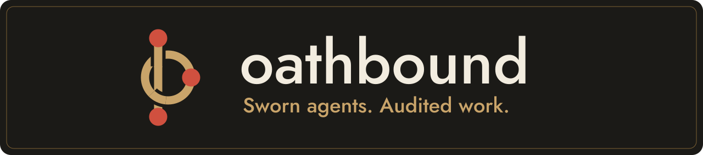

# Oathbound



Conjunto portátil de governança, regras de execução, subagentes especializados, guardrails determinísticos em hooks, trilha de auditoria e skills de engenharia para assistentes de IA baseados em CLI.

- **Estágio:** alpha / incompleto, com protótipos em calibração (versão em [VERSION](VERSION) e histórico em [CHANGELOG.md](CHANGELOG.md)).
- **Stack:** TypeScript e JavaScript nativos em **Node.js 24+** (type stripping nativo, sem etapa de build e sem dependências externas).
- **Alvos suportados:** **Claude Code** (`claude`), **Antigravity CLI** (`agy`) e **Codex CLI** (plugin, agentes e hooks opcionais).

---

## O que o projeto faz

1. **Regras de Governança:** O `oathkeeper` aplica o fluxo comum como agente no Claude Code e no Antigravity CLI, e como perfil no Codex CLI. Cada projeto define suas exceções locais.
2. **Subagentes Especializados:** O `oathkeeper` coordena 7 subagentes: `scout`, `scholar`, `scribe`, `smith`, `assayer`, `sentinel` e `breaker`.
3. **Skills de Engenharia:** [`api-contract-design`](skills/api-contract-design/SKILL.md), [`create-adr`](skills/create-adr/SKILL.md), [`create-spec`](skills/create-spec/SKILL.md), `diagnosing-bugs`, `grill-me`, [`incident-postmortem`](skills/incident-postmortem/SKILL.md), `migration`, [`refactor-safely`](skills/refactor-safely/SKILL.md), `surgical-patch` e [`test-strategy`](skills/test-strategy/SKILL.md). Skills com tools específicas de CLI suportam override opcional `SKILL.<runner>.md` (ADR 0006). O `scribe` carrega `create-adr` e `create-spec` sob demanda.
4. **Hooks Determinísticos:** Auditoria e proteção em tempo de execução com `agent-audit`, `readonly-guard`, `read-size-guard` e `destructive-guard` no binário nativo Rust (`native/oathbound-hook`), que também fornece `statusline`. A reescrita de comandos usa os hooks oficiais do RTK.
5. **Telemetria, Relatórios e Protótipos:** Inclui `audit-resumo`, módulos de custo e dificuldade (`test/custo`, `test/dificuldade`) e protótipos inativos com Jev (`claude/hooks/skill-suggest.js`, `test/jev/revisar-teste.js`) documentados nos ADRs [docs/adr/0001-sugestao-de-skill-com-jev.md](docs/adr/0001-sugestao-de-skill-com-jev.md), [docs/adr/0002-roteamento-de-subagentes-com-jev.md](docs/adr/0002-roteamento-de-subagentes-com-jev.md) e [docs/adr/0003-jev-revisao-de-testes.md](docs/adr/0003-jev-revisao-de-testes.md).

---

## Instalação

O Oathbound pode ser instalado como plugin nativo ou através do instalador em Node.js.

### 1. Plugin Nativo

No Claude Code, instale pelo marketplace com `/plugin install oathbound --marketplace RaphaelVSouza/Oathbound`.

Se já usa o marketplace, atualize-o e recarregue o plugin pelo painel `/plugin`. Se usa o pacote de release, gere ou extraia a nova versão em outro diretório e aponte o Claude para ele.

Para iniciar uma sessão Oathbound no Claude, use `claude --agent oathbound:oathkeeper`. No agy, use `agy agents` para conferir os agentes disponíveis e selecione o `oathkeeper` com `agy --agent oathkeeper`.

Inicie a CLI normalmente para manter o agente padrão. Na sessão, peça pelo subagente desejado, por exemplo, `oathbound:scout` no plugin Claude ou `scout` no agy.

No plugin Claude, o hook aplica guards pelo identificador `oathbound:<agente>` e registra bloqueios. Logs novos usam modo `0600` em Unix e herdam as permissões do diretório no Windows. Logs antigos podem conter detalhes gravados por versões anteriores.

Com Dynamic Workflows habilitado no Claude, execute `/oathbound:revisao-arquitetura` e informe a decisão, os módulos e as restrições. O workflow compara contratos, operação e migração. A quarta chamada verifica referências e reúne subsídios para um ADR. Aprove a decisão antes de pedir implementação ou registro do ADR.
Os manifestos de origem ficam separados por harness: [Claude Code](.claude-plugin/plugin.json), com seu [marketplace](.claude-plugin/marketplace.json), e [Antigravity](.antigravity-plugin/plugin.json). Para gerar pacotes nativos independentes, informe diretórios novos dentro do repositório:

```sh
node tools/build-plugin.cjs claude dist/claude
node tools/build-plugin.cjs agy dist/agy
claude plugin validate dist/claude
agy plugin validate dist/agy
```

Crie `dist/` antes de gerar os pacotes. O gerador exige destinos novos. Cada pacote contém as skills e oito agentes. O pacote Claude inclui os guards por agente, que requerem Node.js.

### 2. Plugin local para Codex CLI

Crie `dist/` e use um destino novo. A instalação é manual pelo marketplace local.
Validação de referência com Codex CLI `0.170.0`.

```sh
node tools/build-plugin.cjs codex dist/codex
codex plugin marketplace add ./dist/codex
codex plugin add oathbound@oathbound-local
codex plugin list --marketplace oathbound-local --json
```

Para instalar os sete agentes no projeto, execute `node tools/install.ts --runner codex --project .`.
Os prompts ficam em `codex/agents/`, no campo `developer_instructions` de cada TOML. Os agentes indicam as evidências, validações e lacunas esperadas em cada papel. O perfil `oathkeeper` planeja revisões grandes em lotes e leva lacunas abertas ao relatório final.
Use `--global` no lugar de `--project .` para instalá-los em `~/.codex/agents/`.
Se você usa um `CODEX_HOME` personalizado, copie os TOMLs para a pasta `agents/` desse diretório.
Quem instala a partir do GitHub Release encontra os TOMLs em `setup/agents/` e pode copiá-los para `.codex/agents/`, preservando arquivos existentes.

Inicie `codex -p oathkeeper` para carregar as instruções da sessão principal.
A instalação global inclui o perfil. Na instalação por projeto ou pelo GitHub Release, copie `codex/oathkeeper.config.toml` ou `setup/oathkeeper.config.toml` para o diretório `CODEX_HOME` (padrão `~/.codex/`), preservando arquivos existentes.
Para ativar os hooks opcionais, coloque o binário nativo da sua plataforma no PATH com o nome `oathbound-hook`.
Copie `setup/hooks.json` para `.codex/hooks.json` ou acrescente suas entradas ao arquivo existente.
Revise e confie nas definições com `/hooks`. O guard Bash se aplica à sessão inteira.
Execute no terminal externo as ações autorizadas que o guard bloquear.
[ADR do plugin Codex](docs/adr/0005-plugin-codex.md)

### 3. Instalador de Projeto e Ambiente (`install.ts`)

Na migração de manifestos antigos, o instalador conserva arquivos divergentes e mostra o diff para revisão. A limpeza automática exige registro de origem no manifesto atual.

Para agentes locais preservados de instalações antigas, revise o diff do instalador e aplique a delimitação dos caminhos dos hooks.

Gerencie skills do plugin pelo comando `/plugin` do Claude Code. Use `--no-dedupe-skills` para conservar as cópias locais durante a instalação.
Para gerenciar a instalação e atualização em ambientes globais ou diretórios de projeto específicos, execute:

```sh
node tools/install.ts [opções]
```

**Opções suportadas:**
- `--global`: Instala agentes e skills em `~/.claude/` e `~/.gemini/config/`. O manifesto e os scripts usados pelos guards dos agentes Claude ficam em `~/.oathbound/`.
- `--project <dir>`: Instala em diretório específico gerando `.claude/`, `.agents/`, `.oathbound/manifest.json`, `.agents/skills.json` e `_disabled/`.
- `--runner all|claude|agy|codex`: Seleciona o runner. `all` inclui Claude Code e Antigravity CLI. Com `--global`, o runner `codex` instala os agentes e o perfil.
- `--upgrade`: Atualiza uma instalação existente apresentando o diff de alterações.
- `--statusline`: Configura a barra de status do Claude em instalações de projeto.
- `--audit-docs`: Instala a configuração de auditoria de documentação (exclusivo para projetos).
- `--no-dedupe-skills`: Desativa a desduplicação automática de skills duplicadas.

O instalador valida manifestos SHA-256 (`.oathbound/manifest.json`), preserva alterações locais e desativa skills duplicadas sem utilizar symlinks (através de marcação e mapeamento em `_disabled` / `skills.json`).

O instalador global preserva instruções, configurações, hooks compartilhados e skills existentes. Se uma versão anterior registrou regras ou hooks globais do Oathbound, revise esses registros antes de removê-los manualmente.

Use os hooks oficiais `rtk hook claude`, `rtk hook codex` e `rtk hook antigravity` em `PreToolUse`. O upgrade de projeto Antigravity migra o registro legado do Oathbound. Em PowerShell sem um executável `ls` no PATH, preserve o alias com `ls` em `[hooks].exclude_commands` na configuração do RTK.

### 4. Atualização de instalações globais para 0.50.0-alpha.37

A partir da raiz do repositório atualizado, execute:

```sh
node tools/install.ts --global --runner all --upgrade
node tools/install.ts --global --runner codex --upgrade
```

Abra uma nova sessão para carregar os novos nomes:

- Claude Code (instalação avulsa): `claude --agent oathkeeper`.
- Antigravity CLI: `agy --agent oathkeeper`.
- Codex CLI: `codex -p oathkeeper`.

Após confirmar os substitutos, incorpore eventuais personalizações e arquive os arquivos antigos fora dos diretórios ativos:

- Claude Code: arquive `orquestrador.md` e `tester.md` de `~/.claude/agents/`.
- Antigravity CLI: arquive `orquestrador.md` e `tester.md` de `~/.gemini/config/agents/`.
- Codex CLI: arquive `agents/tester.toml` e `oathbound.config.toml` de `CODEX_HOME` (padrão `~/.codex/`).

---

## Validação e Qualidade

Para rodar os testes unitários utilizando os recursos nativos do Node.js 24+:
```sh
node --test --experimental-test-coverage test/*.test.ts test/*/*.test.js
```

Para executar o auditor de documentação (integridade de links, âncoras e portabilidade):
```sh
node tools/audit-docs.ts
node tools/audit-docs.ts --staged
```

Consulte também os documentos de referência:
- [Referências oficiais por harness](docs/README.md)
- [Como Contribuir](CONTRIBUTING.md)
- [Instruções do Pacote](AGENTS.md)
- [Changelog](CHANGELOG.md)
- [Guia de Ferramentas](tools/README.md)
- [Licença](LICENSE)
