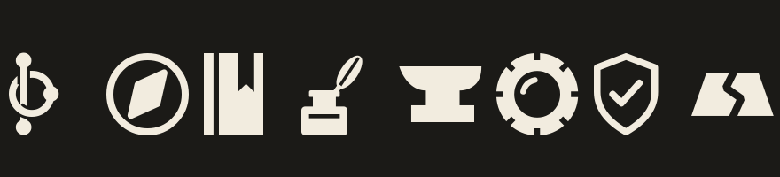

# Oathbound icon glyphs

`OathboundIcons.ttf` holds the logo and the seven subagent icons as monochrome glyphs in the Private Use Area, so a terminal status line can show them as text. The glyphs are the foreground shapes of `assets/logo.svg` and `assets/readme-agents.svg`, without the colored tile.



| Glyph | Code point | Name |
|---|---|---|
| logo | `U+EF00` | oathbound |
| scout | `U+EF01` | scout |
| scholar | `U+EF02` | scholar |
| scribe | `U+EF03` | scribe |
| smith | `U+EF04` | smith |
| assayer | `U+EF05` | assayer |
| sentinel | `U+EF06` | sentinel |
| breaker | `U+EF07` | breaker |

## Use

Install the font, then add it to your terminal font list. Print a glyph with `printf '\xee\xbc\x80'` (`U+EF00`) or tint it with ANSI color. Without the font a terminal shows an empty box, so keep a fallback such as `◆`.

The status line uses these glyphs when `OATHBOUND_STATUSLINE_ICONS=oathbound` is set (see ADR-0019); the default is plain Unicode.

The font is opt-in and per machine: a plugin cannot install fonts. Whether Claude Code measures these code points as one column in its status line is unverified.

## Rebuild

`build-glyph-font.py` is an offline tool outside the plugin and the tests. It needs Python with `fonttools` and `skia-pathops`:

```
python -m venv .scratch/glyphenv
.scratch/glyphenv/Scripts/python.exe -m pip install fonttools skia-pathops
.scratch/glyphenv/Scripts/python.exe assets/glyphs/build-glyph-font.py assets/glyphs
```

The code points avoid the ranges used by Nerd Fonts, Powerline, Codicons and Font Awesome. This was checked against the Nerd Fonts glyph-set page only, not against every font.
