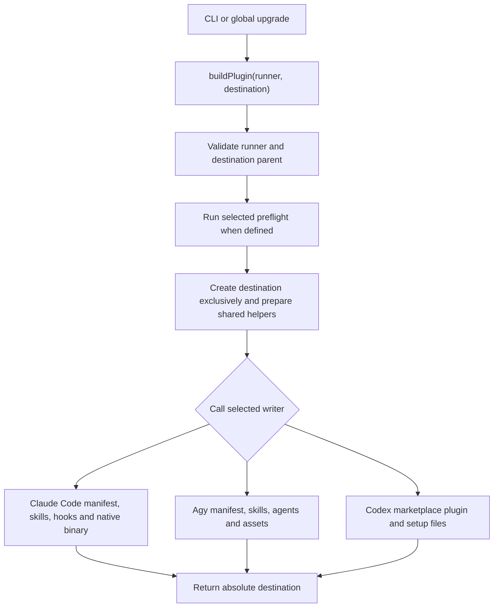

# 0020 - Use host-specific strategies to build plugin packages

## Context and Problem Statement

`buildPlugin(runner, destination)` validates the destination, resolves Claude's native binary, provides file helpers, and writes three host-specific package layouts. Codex takes an early branch, while Claude Code and Antigravity share part of the write sequence. Both the build CLI and global upgrade depend on the builder. Maintainers adding a host-specific artifact must trace the shared flow and the relevant branches to find the correct place to write it.

## Decision Drivers

- Make a host-specific package change local to that host's writer and package tests.
- Give version, manifest, and skill selection rules one implementation.
- Preserve generated artifacts and the builder's CLI and module contracts, including failure behavior.
- Keep the design small enough to follow in one file and use the existing Node APIs.

## Considered Options

| Option | Benefit | Cost |
| --- | --- | --- |
| Keep the inline branches | No transition effort. The full flow is visible in one function. | Host layout changes still require tracing shared and host-specific branches. |
| Extract three writers and dispatch with a `switch` | Isolates each layout with straightforward control flow. | Claude's preflight and writer selection happen at different points in the shared flow, so the builder must coordinate both. |
| Use a function-based Strategy per host | Each writer shows the full host layout. The builder owns sequencing and shared rules. | Adds an internal interface and one level of dispatch. |
| Describe packages through a declarative file map | Plain copies become easy to scan and compare. | Native binary preflight, executable permissions, skill selection, and generated manifests need special operations. |

## Decision Outcome

Use a fixed strategy map in `tools/build-plugin.cjs`. A single lookup pairs each host's writer with its optional preflight, so the builder can run the same sequence for all three hosts. This keeps Claude's native input requirement next to its layout and gives shared version and skill rules one home. Keep the writers in the builder during the initial extraction. Accept only the three explicit keys `claude`, `agy`, and `codex`.

| Owner | Responsibility |
| --- | --- |
| Builder | Validate the supported runner and destination, call preflight before creating the output, create the directory exclusively, read `VERSION`, and return the absolute output path. |
| Shared helpers | Copy source files, write JSON exclusively, normalize plugin manifests, and copy shared and runner-specific skills using the writer's destination. |
| Claude Code strategy | Resolve the native binary during preflight. Write the Claude layout, derive the packaged filename from the input binary's extension, and explicitly set the output mode to `0o755`. |
| Agy strategy | Write the Antigravity manifest, skills, agents, and assets. |
| Codex strategy | Write the marketplace layout, MCP footer, skills, and setup files. Keep both footer copies. |

The internal interface is `write(context, preparedInputs)` with optional `prepare()`. The context supplies the shared file operations and output directory. Claude's prepared input contains the binary path. The writer owns relative output paths, including where its skills go. Existing CommonJS exports remain available to callers, including `findNativeHookBinary` and `copySkillsForRunner`.

### Consequences

- **Good.** Adding a Codex setup file changes the Codex writer and its package test. A manifest versioning change belongs in the shared helper.
- **Bad.** The strategy map introduces another call boundary, and writes can still fail partway through a build. Keep the interface small and preserve existing sequencing and failure behavior during extraction.
- **Neutral.** Apply the pattern to package generation. Host installation, hook execution, and release orchestration continue through their existing entry points.

### Confirmation

- Compare relative paths and file contents for all three packages before and after extraction using the same inputs. Check executable mode on a POSIX runner.
- Run the package and global upgrade tests. Verify runner-specific skills, manifest versions, and the Codex plugin and setup trees. Supplement the upgrade test with a staging smoke check that uses the real exported builder and native lookup with a temporary home. The package builder supports Agy and Codex without a binary. Global Codex upgrade resolves a native binary separately.
- Exercise the real builder with an unsupported runner such as `constructor` and expect the usage error. Check that destination-parent validation precedes Claude binary lookup. With a valid parent and no binary, expect the missing-binary error for both a new and an existing destination, with no output created or overwritten. With a valid binary and an existing destination, expect `EEXIST` and preserve its contents.
- Verify that Claude's packaged filename follows the input extension across build hosts.
- Review the next host-only packaging change. Its layout changes should fit in one writer and the corresponding package assertions.

## References

- [Package builder](../../tools/build-plugin.cjs)
- [Package tests](../../test/build-plugin.test.cjs)
- [Global upgrade](../../tools/upgrade-global.ts)
- [ADR-0009 — Per-platform native hook packaging](0009-per-platform-native-hook-packaging.md)
