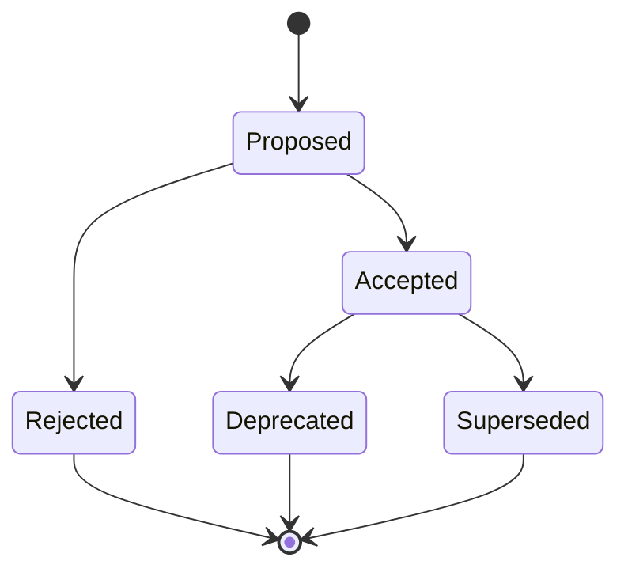

# Como escrever uma ADR

- **Caminho:** `docs/adr/como-escrever-adr.md`
- **Template:** [adr-template.md](adr-template.md)
- **Data:** 2026-11-19
- **Aplica-se a:** novas decisões de arquitetura do Oathbound.

Este guia define quando escrever uma ADR (_Architecture Decision Record_), como redigir cada seção e como ela passa por Git e Pull Requests até virar registro permanente.

---

## 1. Quando escrever (e quando não escrever)

ADR é para decisão **arquiteturalmente significativa**. Escrever ADR para tudo gera burocracia e o processo morre. Uma decisão é significativa quando afeta pelo menos um destes cinco eixos (critério de Richards & Ford, _Fundamentals of Software Architecture_, adotado pelo guia da AWS):

| Eixo                          | Exemplos                                                                                            |
| ----------------------------- | --------------------------------------------------------------------------------------------------- |
| **Estrutura**                 | Monolito modular vs. microsserviços; mensageria assíncrona vs. chamadas síncronas                   |
| **Requisitos não funcionais** | Segurança, disponibilidade, tolerância a falhas, latência, observabilidade, custo de infraestrutura |
| **Dependências**              | Acoplamento entre serviços; escolha de banco, _broker_, provedor de identidade, addons de terceiros |
| **Interfaces**                | Contratos públicos, versionamento de APIs, esquemas de eventos, escopos de integração               |
| **Técnicas de construção**    | Linguagem, framework principal, estratégia de _branching_/_deploy_, bibliotecas difíceis de trocar  |

**Teste rápido:** existem **duas ou mais opções viáveis** e **reverter daqui a seis meses seria caro ou arriscado**? Então escreva uma ADR.

**Não escreva ADR para:**

- Decisões fáceis de reverter ou restritas a um único módulo interno.
- Regras de formatação e estilo: essas ficam no _linter_ (ESLint, Prettier, Ruff, Roslyn), não em documento.
- Especificação detalhada de implementação: isso é papel de uma **Tech Spec / RFC**. A RFC _explora e desenha_ a solução; a ADR registra o _veredito e os trade-offs_, de forma curta e permanente. Uma RFC pode gerar uma ou mais ADRs, e a ADR aponta para a RFC em _Referências_.

---

## 2. Como redigir cada seção

Uma ADR deve ser lida em **5 a 10 minutos** (1 a 2 páginas). Ela foca no **porquê** da decisão, não no passo a passo da implementação. Se o texto passar muito disso, o excesso provavelmente pertence a uma RFC, a um _runbook_ ou a anexos referenciados.

| Seção                         | Obrigatória?        | Regra                                                                                         |
| ----------------------------- | ------------------- | --------------------------------------------------------------------------------------------- |
| **Título**                    | Sim                 | Frase curta que **afirma a decisão**, nunca uma pergunta ou um tema.                          |
| **Metadados**                 | Sim                 | `status`, `date` e `decision-makers`; `consulted` e `informed` quando houver.                 |
| **Contexto e Problema**       | Sim                 | Fatos, restrições e forças em tensão, em **tom neutro**.                                      |
| **Fatores de Decisão**        | Opcional            | Critérios que as opções precisam atender (RNFs, custo, prazo, compliance).                    |
| **Opções Consideradas**       | Sim                 | Todas as alternativas **viáveis** avaliadas, inclusive "não fazer nada" quando fizer sentido. |
| **Decisão**                   | Sim                 | Opção escolhida, em **voz ativa**, ligada aos fatores.                                        |
| **Consequências**             | Sim (neste projeto) | Impactos **bons, ruins e neutros**.                                                           |
| **Confirmação**               | Recomendada         | Como verificar que a decisão foi implementada e continua sendo seguida.                       |
| **Prós e Contras das Opções** | Opcional            | Detalhe por opção, para decisões com trade-offs não triviais.                                 |
| **Referências**               | Opcional            | RFC, _benchmarks_, _issues_, ADRs relacionadas.                                               |

### Título

- _Ruim:_ `Escolha do banco de dados` · `Devemos usar Redis?`
- _Bom:_ `0004 - Usar PostgreSQL como banco transacional principal`

### Metadados

- `status`: um dos estados da seção 3.
- `date`: data da **última mudança de status** (`AAAA-MM-DD`).
- `decision-makers`: quem aprova (rastreabilidade).
- `consulted` / `informed` (opcionais): quem deu opinião técnica e quem só precisa saber da decisão.

### Contexto e Problema

Descreva o cenário como ele era na época: restrições (prazo, orçamento, tamanho da equipe, legado, SLA), números relevantes e o problema que exige decisão. **Não venda a solução aqui.** Quem ler daqui a dois anos precisa entender por que a decisão fazia sentido _naquele_ contexto.

### Opções Consideradas

Liste as alternativas com prós e contras objetivos. Isso evita que o time rediscuta, meses depois, uma opção já descartada por um motivo válido. Opções inventadas só para "perder" (falso dilema) invalidam a ADR — veja a seção 6.

### Decisão

Frases completas em voz ativa: _"Adotaremos X porque..."_. Cada justificativa deve apontar para um fator ou força descrito no Contexto. Se a decisão vale só para código novo, diga isso aqui (seção 4.6).

### Consequências

Liste os efeitos **positivos, negativos e neutros**: débitos técnicos aceitos, custos operacionais, novos riscos e o que muda para quem mantém o sistema. Para cada consequência negativa relevante, registre a mitigação. **Uma ADR que só lista pontos positivos é propaganda, não documentação de engenharia.**

### Confirmação

Diga como a conformidade será verificada: teste automatizado, regra de _lint_ ou de arquitetura, checklist de _code review_, critério de _Go/No-Go_ de uma PoC. Sem confirmação, a decisão tende a ser esquecida.

---

## 3. Ciclo de vida (máquina de estados)

| Status                     | Significado                                                   | Próximos estados válidos               |
| -------------------------- | ------------------------------------------------------------- | -------------------------------------- |
| **Proposed**               | Em discussão/revisão no PR. Pode ser editada livremente.      | `Accepted`, `Rejected`                 |
| **Accepted**               | Decisão vigente. Conteúdo imutável.                           | `Deprecated`, `Superseded by ADR-NNNN` |
| **Rejected**               | Avaliada e descartada; fica como histórico, com o motivo.     | _(estado final)_                       |
| **Deprecated**             | Não se aplica mais (ex.: serviço ou funcionalidade removida). | _(estado final)_                       |
| **Superseded by ADR-NNNN** | Substituída por uma decisão mais recente.                     | _(estado final)_                       |

---

## 4. Fluxo no Git

### 4.1 Onde e como nomear

- Arquivos Markdown em **`docs/adr/`**, versionados junto com o código.
- Decisões que atravessam vários repositórios ficam em um repositório central de arquitetura (ou espelhadas em uma wiki interna), com link a partir dos repositórios afetados.
- Nome: **quatro dígitos + kebab-case**: `0002-estrategia-de-autenticacao.md`.
- Numeração **sequencial e monotônica**. Nunca reutilize um número, nem de ADR rejeitada.

### 4.2 Passo a passo

1. Crie uma _branch_ (`adr/0002-estrategia-de-autenticacao`).
2. Copie `docs/adr/adr-template.md` para o próximo número livre e preencha com `status: Proposed`.
3. Abra um PR só com a ADR (ou com a ADR e uma PoC pequena, se ela for evidência da decisão).
4. **Revisão:** os revisores leem a ADR inteira antes de comentar. Em reunião de revisão, reserve os primeiros 10–15 minutos para leitura silenciosa e comentários no próprio PR; depois, o _owner_ passa pelos comentários com o time.
5. Se surgirem ações pendentes (ex.: medir algo, consultar alguém), a ADR **continua `Proposed`**: o _owner_ distribui as ações e marca nova revisão.
6. Aprovada: o _owner_ muda o status para `Accepted`, atualiza `date` e `decision-makers` e faz o _merge_ **no mesmo PR**.
7. Recusada: o status vira `Rejected`, o motivo é registrado na seção _Decisão_, e o arquivo é mesclado mesmo assim, para que o histórico exista.

### 4.3 Ownership

Qualquer engenheiro do time pode propor e ser **owner** de uma ADR — não centralize em arquitetos ou _tech leads_. O _owner_ conduz a revisão, consolida os comentários e aprova as mudanças de conteúdo enquanto a ADR estiver `Proposed`.

### 4.4 Imutabilidade

Depois de `Accepted` ou `Rejected`, o **mérito** da ADR não é reescrito.

- **Permitido:** mudar o status (`Deprecated`, `Superseded by ADR-NNNN`), corrigir erro de digitação ou link quebrado, adicionar link para a ADR que a substitui.
- **Proibido:** mudar opção escolhida, justificativas ou consequências.
- **Mudou de ideia?** Crie uma nova ADR (ex.: `0018`) que referencia a antiga, e altere **apenas** o status da antiga (`0004`) para `Superseded by ADR-0018`, no mesmo PR.
- **Nunca apague** uma ADR: é a memória institucional do time.

Enquanto a ADR está `Proposed`, ela pode evoluir livremente. Se as revisões forem muitas (como numa PoC longa), mantenha um _Histórico de revisões_ curto no topo; ele deixa de crescer quando a ADR é aceita.

### 4.5 ADRs no _code review_

- Se um PR de código viola uma ADR `Accepted`, o revisor pede o ajuste e **cola o link da ADR** no comentário.
- Se a decisão não faz mais sentido, o autor abre uma **nova ADR** propondo a mudança, em vez de quebrar o padrão em silêncio.
- PRs que implementam uma decisão citam a ADR na descrição (ex.: `Implementa ADR-0004`).

### 4.6 Código legado não conforme

Aprovar uma ADR não obriga a parar a _sprint_ para reescrever o sistema. A ADR deve dizer explicitamente que a regra vale para **código novo** e como o legado será tratado: migração gradual ao mexer no código, ou tarefas explícitas de débito técnico no _backlog_. _(Prática deste time; o guia da AWS não trata do assunto.)_

---

## 5. Checklist de revisão

Antes de aprovar, o revisor confere:

- [ ] A decisão passa no teste da seção 1 (significativa, com opções viáveis e reversão cara).
- [ ] O título afirma a decisão; o nome do arquivo segue `NNNN-kebab-case.md` com número novo.
- [ ] Metadados completos (`status`, `date`, `decision-makers`).
- [ ] O Contexto é neutro e traz as restrições reais da época.
- [ ] As opções são todas viáveis — nenhuma está lá só para perder.
- [ ] A justificativa da Decisão se conecta aos fatores e ao Contexto.
- [ ] Há consequências **negativas** registradas, com mitigação quando relevante.
- [ ] A Confirmação diz como verificar a conformidade.
- [ ] Cabe em 5–10 minutos de leitura; detalhes de implementação estão na RFC ou em anexos.
- [ ] Se substitui outra ADR, o status da antiga foi atualizado no mesmo PR.

---

## 6. Antipadrões

- **"Eterno Proposed":** a discussão é aberta, o código é implementado e ninguém atualiza o status no _merge_.
- **Falso dilema:** a solução preferida ao lado de duas opções obviamente absurdas, só para cumprir tabela.
- **Omitir consequências negativas:** esconder custo de manutenção ou complexidade gera surpresas e destrói a confiança na documentação.
- **Apagar ADRs antigas:** o time perde a memória e repete erros já superados.
- **ADR como ata de reunião:** não copie a transcrição do debate; sintetize forças, alternativas, veredito e efeitos.
- **ADR como especificação:** passo a passo de implementação, configuração completa e cronograma pertencem à RFC, ao _runbook_ ou ao plano do projeto.
- **Reescrever ADR aceita:** mudar o mérito de uma ADR `Accepted` em vez de criar uma nova que a substitua.

---

## 7. Template

O template oficial do projeto está em **`docs/adr/adr-template.md`**. Ele segue o **MADR 4.0** (_Markdown Architectural Decision Records_), com as seções traduzidas e _Consequências_ tornada obrigatória. O MADR une a leveza do formato original de Nygard com a seção estruturada de opções consideradas.

| MADR 4.0 (original)           | Este projeto              |
| ----------------------------- | ------------------------- |
| Context and Problem Statement | Contexto e Problema       |
| Decision Drivers              | Fatores de Decisão        |
| Considered Options            | Opções Consideradas       |
| Decision Outcome              | Decisão                   |
| Consequences                  | Consequências             |
| Confirmation                  | Confirmação               |
| Pros and Cons of the Options  | Prós e Contras das Opções |
| More Information              | Referências               |

---

## 8. Fontes

- **MADR 4.0** — especificação e templates (completo, mínimo e _bare_): <https://adr.github.io/madr/> e <https://github.com/adr/madr>.
- **AWS Prescriptive Guidance** — _Using architectural decision records to streamline decision-making during development_: <https://docs.aws.amazon.com/prescriptive-guidance/latest/architectural-decision-records/> (processo, _ownership_, revisão, status, imutabilidade e uso em _code review_).
- **Google Cloud Architecture Center** — _Architecture decision records overview_: <https://docs.cloud.google.com/architecture/architecture-decision-records> (quando criar e onde armazenar).
- **Michael Nygard (2011)** — _Documenting Architecture Decisions_: artigo original do formato enxuto, da imutabilidade e da voz ativa.
- **Mark Richards & Neal Ford (2020)** — _Fundamentals of Software Architecture_ (O'Reilly): critérios de significância arquitetural e antipadrões.
- **Olaf Zimmermann** — _How to create Architectural Decision Records (ADRs) — and how not to_ e _How to review ADRs_ (blog ozimmer.ch): padrões, antipadrões e checklists de revisão.
- **Joel Parker Henderson** — catálogo de templates e exemplos: <https://github.com/joelparkerhenderson/architecture-decision-record>.
