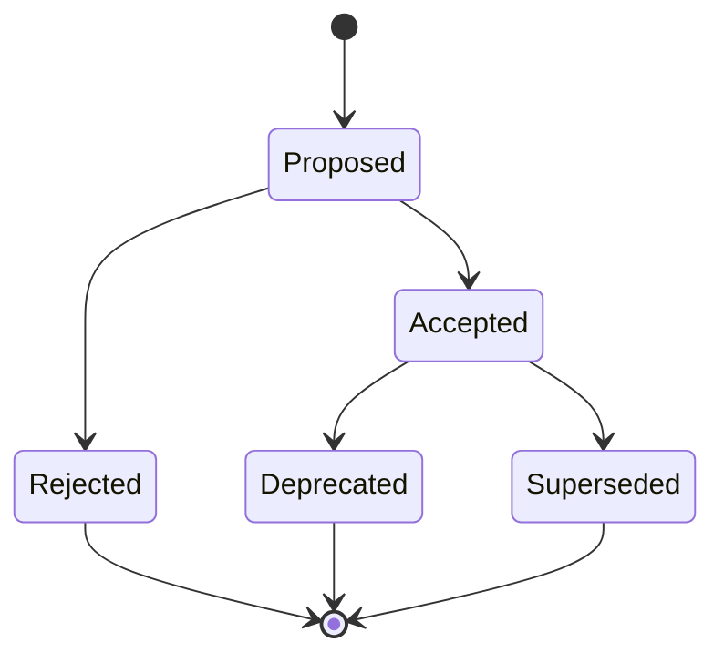

# How to Write an ADR

- **Path:** `docs/adr/como-escrever-adr.md`
- **Template:** [adr-template.md](adr-template.md)
- **Date:** 2026-11-19
- **Applies to:** new Oathbound architecture decisions.

This guide defines when to write an ADR (_Architecture Decision Record_), how to draft each section and how it moves through Git and Pull Requests into a permanent record.

---

## 1. When to Write (and When Not to Write)

An ADR is for an **architecturally significant** decision. Writing ADRs for everything creates bureaucracy and kills the process. A decision is significant when it affects at least one of these five dimensions (Richards & Ford's criterion from _Fundamentals of Software Architecture_, adopted by the AWS guide):

| Dimension | Examples |
| --- | --- |
| **Structure** | Modular monolith vs. microservices; asynchronous messaging vs. synchronous calls |
| **Non-functional requirements** | Security, availability, fault tolerance, latency, observability, infrastructure cost |
| **Dependencies** | Service coupling; choice of database, _broker_, identity provider, third-party addons |
| **Interfaces** | Public contracts, API versioning, event schemas, integration scopes |
| **Construction techniques** | Language, primary framework, _branching_/_deployment_ strategy, hard-to-replace libraries |

**Quick test:** are there **two or more viable options**, and **would reversing the decision in six months be expensive or risky**? Then write an ADR.

**Do not write ADRs for:**

- Decisions that are easy to reverse or limited to a single internal module.
- Formatting and style rules: these belong in the _linter_ (ESLint, Prettier, Ruff, Roslyn), not a document.
- Detailed implementation specifications: these belong in a **Tech Spec / RFC**. The RFC _explores and designs_ the solution; the ADR records the _verdict and trade-offs_, briefly and permanently. An RFC can produce one or more ADRs, and the ADR links to the RFC under _References_.

---

## 2. How to Draft Each Section

An ADR should take **5 to 10 minutes** to read (1 to 2 pages). It focuses on **why** the decision was made, not implementation steps. If the text substantially exceeds this, the excess probably belongs in an RFC, _runbook_ or linked appendix.

| Section | Required? | Rule |
| --- | --- | --- |
| **Title** | Yes | Short sentence **stating the decision**, never a question or topic. |
| **Metadata** | Yes | `status`, `date` and `decision-makers`; `consulted` and `informed` when applicable. |
| **Context and Problem Statement** | Yes | Facts, constraints and competing forces, in a **neutral tone**. |
| **Decision Drivers** | Optional | Criteria the options must meet (NFRs, cost, deadline, compliance). |
| **Considered Options** | Yes | All **viable** alternatives evaluated, including "do nothing" when appropriate. |
| **Decision Outcome** | Yes | Chosen option, in **active voice**, tied to the drivers. |
| **Consequences** | Yes (in this project) | **Good, bad and neutral** impacts. |
| **Confirmation** | Recommended | How to verify the decision was implemented and remains followed. |
| **Pros and Cons of the Options** | Optional | Per-option detail for decisions with nontrivial trade-offs. |
| **References** | Optional | RFC, _benchmarks_, _issues_, related ADRs. |

### Title

- _Bad:_ `Database choice` · `Should we use Redis?`
- _Good:_ `0004 - Use PostgreSQL as the primary transactional database`

### Metadata

- `status`: one of the states in section 3.
- `date`: date of the **last status change** (`YYYY-MM-DD`).
- `decision-makers`: who approves (traceability).
- `consulted` / `informed` (optional): who provided technical input and who only needs to know the decision.

### Context and Problem Statement

Describe the situation as it was at the time: constraints (deadline, budget, team size, legacy, SLA), relevant numbers and the problem requiring a decision. **Do not sell the solution here.** Someone reading in two years must understand why the decision made sense in _that_ context.

### Considered Options

List alternatives with objective pros and cons. This prevents the team from reopening an option months later that was already rejected for a valid reason. Options invented just to "lose" (false dilemma) invalidate the ADR — see section 6.

### Decision Outcome

Full sentences in active voice: _"We will adopt X because..."_. Each rationale must point to a driver or force described in Context. If the decision applies only to new code, state that here (section 4.6).

### Consequences

List **positive, negative and neutral** effects: accepted technical debt, operational costs, new risks and what changes for maintainers. For each relevant negative consequence, record mitigation. **An ADR listing only positives is advertising, not engineering documentation.**

### Confirmation

State how compliance will be verified: automated test, _lint_ or architecture rule, _code review_ checklist, PoC _Go/No-Go_ criterion. Without confirmation, the decision tends to be forgotten.

---

## 3. Lifecycle (State Machine)

| Status | Meaning | Valid Next States |
| --- | --- | --- |
| **Proposed** | Under discussion/review in a PR. May be freely edited. | `Accepted`, `Rejected` |
| **Accepted** | Current decision. Immutable content. | `Deprecated`, `Superseded by ADR-NNNN` |
| **Rejected** | Evaluated and discarded; retained as history, with a reason. | _(final state)_ |
| **Deprecated** | No longer applies (e.g. service or feature removed). | _(final state)_ |
| **Superseded by ADR-NNNN** | Replaced by a newer decision. | _(final state)_ |

---

## 4. Git Workflow

### 4.1 Location and Naming

- Markdown files in **`docs/adr/`**, versioned with the code.
- Decisions spanning several repositories live in a central architecture repository (or mirrored in an internal wiki), linked from affected repositories.
- Name: **four digits + kebab-case**: `0002-estrategia-de-autenticacao.md`.
- **Sequential, monotonically increasing** numbering. Never reuse a number, even from a rejected ADR.

### 4.2 Step by Step

1. Create a _branch_ (`adr/0002-estrategia-de-autenticacao`).
2. Copy `docs/adr/adr-template.md` to the next available number and fill it with `status: Proposed`.
3. Open a PR containing only the ADR (or the ADR and a small PoC, if it provides evidence for the decision).
4. **Review:** reviewers read the entire ADR before commenting. In a review meeting, reserve the first 10–15 minutes for silent reading and comments in the PR; then the _owner_ goes through comments with the team.
5. If pending actions arise (e.g. measure something, consult someone), the ADR **remains `Proposed`**: the _owner_ assigns actions and schedules another review.
6. Approved: the _owner_ changes status to `Accepted`, updates `date` and `decision-makers` and merges **in the same PR**.
7. Rejected: status becomes `Rejected`, the reason is recorded under _Decision Outcome_, and the file is merged anyway to preserve history.

### 4.3 Ownership

Any team engineer can propose and **own** an ADR — do not centralize ownership in architects or _tech leads_. The _owner_ leads review, consolidates comments and approves content changes while the ADR is `Proposed`.

### 4.4 Immutability

After `Accepted` or `Rejected`, the ADR's **substance** is not rewritten.

- **Allowed:** change status (`Deprecated`, `Superseded by ADR-NNNN`), fix a typo or broken link, add a link to the superseding ADR.
- **Forbidden:** change the chosen option, rationale or consequences.
- **Changed your mind?** Create a new ADR (e.g. `0018`) referencing the old one, and change **only** the old one's (`0004`) status to `Superseded by ADR-0018`, in the same PR.
- **Never delete** an ADR: it is the team's institutional memory.

While an ADR is `Proposed`, it may evolve freely. If there are many revisions (as in a long PoC), keep a short _Revision History_ at the top; stop extending it when the ADR is accepted.

### 4.5 ADRs in _Code Review_

- If a code PR violates an `Accepted` ADR, the reviewer requests a correction and **pastes the ADR link** in the comment.
- If the decision no longer makes sense, the author opens a **new ADR** proposing the change, rather than silently breaking the standard.
- PRs implementing a decision cite the ADR in their description (e.g. `Implements ADR-0004`).

### 4.6 Noncompliant Legacy Code

Approving an ADR does not require stopping the _sprint_ to rewrite the system. The ADR must explicitly state that the rule applies to **new code** and how legacy code will be handled: gradual migration when touching code, or explicit technical debt tasks in the _backlog_. _(This team's practice; the AWS guide does not address this.)_

---

## 5. Review Checklist

Before approval, the reviewer checks:

- [ ] The decision passes the section 1 test (significant, with viable options and costly reversal).
- [ ] The title states the decision; the filename follows `NNNN-kebab-case.md` with a new number.
- [ ] Complete metadata (`status`, `date`, `decision-makers`).
- [ ] Context is neutral and includes actual constraints at the time.
- [ ] All options are viable — none is included only to lose.
- [ ] Decision Outcome rationale connects to the drivers and Context.
- [ ] **Negative** consequences are recorded, with mitigation where relevant.
- [ ] Confirmation states how to verify compliance.
- [ ] Fits in 5–10 minutes of reading; implementation details are in the RFC or appendices.
- [ ] If superseding another ADR, the old one's status was updated in the same PR.

---

## 6. Antipatterns

- **"Forever Proposed":** discussion opens, code is implemented and nobody updates status on merge.
- **False dilemma:** the preferred solution alongside two obviously absurd options, just to check a box.
- **Omitting negative consequences:** hiding maintenance cost or complexity creates surprises and destroys trust in documentation.
- **Deleting old ADRs:** the team loses its memory and repeats previously resolved mistakes.
- **ADR as meeting minutes:** do not copy debate transcripts; synthesize forces, alternatives, verdict and effects.
- **ADR as specification:** implementation steps, complete configuration and timeline belong in an RFC, _runbook_ or project plan.
- **Rewriting an accepted ADR:** changing the substance of an `Accepted` ADR instead of creating a new one that supersedes it.

---

## 7. Template

The project's official template lives in **`docs/adr/adr-template.md`**. It follows **MADR 4.0** (_Markdown Architectural Decision Records_), with adapted section names and mandatory _Consequences_. MADR combines the lightness of Nygard's original format with a structured section for considered options.

| MADR 4.0 (original) | This Project |
| --- | --- |
| Context and Problem Statement | Context and Problem Statement |
| Decision Drivers | Decision Drivers |
| Considered Options | Considered Options |
| Decision Outcome | Decision Outcome |
| Consequences | Consequences |
| Confirmation | Confirmation |
| Pros and Cons of the Options | Pros and Cons of the Options |
| More Information | References |

---

## 8. Sources

- **MADR 4.0** — specification and templates (full, minimal and _bare_): <https://adr.github.io/madr/> and <https://github.com/adr/madr>.
- **AWS Prescriptive Guidance** — _Using architectural decision records to streamline decision-making during development_: <https://docs.aws.amazon.com/prescriptive-guidance/latest/architectural-decision-records/> (process, _ownership_, review, status, immutability and use in _code review_).
- **Google Cloud Architecture Center** — _Architecture decision records overview_: <https://docs.cloud.google.com/architecture/architecture-decision-records> (when to create and where to store).
- **Michael Nygard (2011)** — _Documenting Architecture Decisions_: original article on the lightweight format, immutability and active voice.
- **Mark Richards & Neal Ford (2020)** — _Fundamentals of Software Architecture_ (O'Reilly): architectural significance criteria and antipatterns.
- **Olaf Zimmermann** — _How to create Architectural Decision Records (ADRs) — and how not to_ and _How to review ADRs_ (ozimmer.ch blog): patterns, antipatterns and review checklists.
- **Joel Parker Henderson** — catalog of templates and examples: <https://github.com/joelparkerhenderson/architecture-decision-record>.
